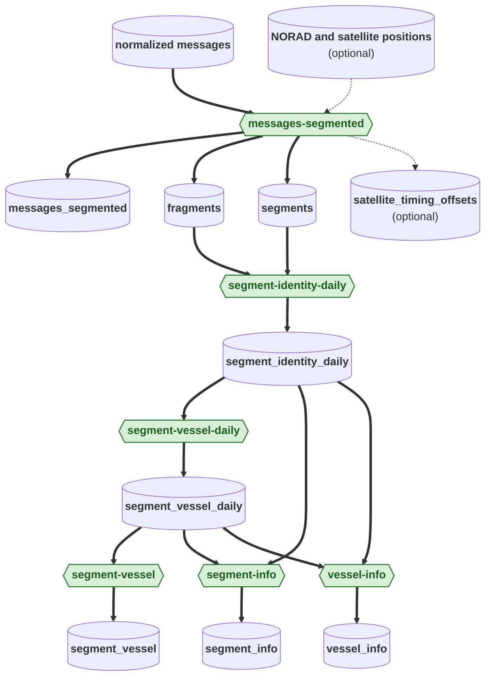

<h1 align="center" style="border-bottom: none;"> pipe-segment </h1>

<p align="center">
  <a href="https://github.com/GlobalFishingWatch/pipe-segment/actions/workflows/main.yml">
    
  </a>
  <a href="https://codecov.io/gh/GlobalFishingWatch/pipe-segment">
    
  </a>
  <a>
    
  </a>
  <a>
    
  </a>
  <a>
    
  </a>
</p>

Divides vessel tracks into *segments*: contiguous pieces of track that come from a single vessel,
separating out noise and signals from two or more vessels that broadcast with the same MMSI
at the same time -- from vessel position data, AIS or VMS.
It also summarizes the identity that each segment broadcasts, and assigns vessel ids.

[contributing guide]: https://github.com/GlobalFishingWatch/python-app-template/blob/main/CONTRIBUTING.md
[preparing the development environment]: https://github.com/GlobalFishingWatch/python-app-template/blob/main/CONTRIBUTING.md#preparing-the-development-environment
[git workflow]: https://github.com/GlobalFishingWatch/python-app-template/blob/main/CONTRIBUTING.md#git-workflow
[python-app-template]: https://github.com/GlobalFishingWatch/python-app-template
[gfw-common]: https://github.com/GlobalFishingWatch/gfw-common
[gpsdio-segment]: https://github.com/GlobalFishingWatch/gpsdio-segment
[pipe-encounters]: https://github.com/GlobalFishingWatch/pipe-encounters
[pipe-research]: https://github.com/GlobalFishingWatch/pipe-research
[Makefile]: Makefile

**Table of contents**:
- [Introduction](#introduction)
- [How it works](#how-it-works)
  * [Full history and incremental runs](#full-history-and-incremental-runs)
  * [How the vessel id is assigned](#how-the-vessel-id-is-assigned)
- [Limitations](#limitations)
- [Development](#development)
- [Usage](#usage)
  * [Using the CLI](#using-the-cli)
  * [Config files](#config-files)
- [References](#references)

## Introduction

<div align="justify">

Global Fishing Watch tracks fishing activity worldwide from the messages that vessels broadcast:
AIS, and VMS. [[1]](#1)
Every message carries an identifier of its source, the *ssvid* (the MMSI, for AIS),
and it is tempting to treat it as the identity of a vessel.
It is not: more than one vessel can broadcast with the same ssvid at the same time,
and some messages are noise.
Any analysis that follows a vessel over time needs to know which messages belong
to the same vessel first.

`pipe-segment` does that.
It splits the messages of each ssvid into *segments*, tracks that are consistent
with the motion of one vessel, so that two vessels sharing an ssvid end up in different segments.
Then it summarizes what each segment broadcasts about its identity
(names, callsigns, IMO numbers, dimensions), and groups the segments that share an identity under a
*vessel id*.
The matching of messages into segments is implemented by [gpsdio-segment].

The other GFW pipelines work from its output:
the segmented messages feed the measures and the position summaries that [pipe-research]
builds, and the segment information is an input of [pipe-encounters], among others.

All the commands run in production *daily*, against both AIS and VMS vessel tracks.

</div>

## How it works

<div align="justify">

The pipeline is a chain of six commands (see [Usage](#usage)).
The first one reads the messages and creates the segments;
the next two summarize their identity per day, and assign a vessel id per day;
the last three summarize the whole history:

</div>



<div align="justify">

The table names are the production ones.

- **`messages-segmented`** reads the normalized messages of the processed dates,
  from one or several tables, and writes three tables, plus an optional fourth one:
  1. Values outside the valid range of each message type (positions, course, speed) are set
     to null.
  2. If the three satellite inputs are given, it computes, per receiver and hour,
     how far the clock of each satellite is from the median of all of them,
     and drops the messages that a satellite received during an hour where the offset exceeds
     `max-timing-offset-s` (30 seconds by default), and `bad-hour-padding` hours around it
     (1 by default). The offsets are written to `satellite_timing_offsets`.
     VMS has no satellites, so it skips this step.
  3. The messages of each ssvid are grouped by UTC day, and [gpsdio-segment] splits each group
     into *fragments*: pieces of a day that are consistent with the motion of one vessel.
     The fragments are written to `fragments`, with their first and last message of the day,
     and the identities that their messages broadcast.
  4. The fragments are matched with the segments that were open the days before.
     A fragment either continues a segment, or starts a new one.
     The segments are written to `segments`, one row per segment and day, with the cumulative
     counts and identities of the segment up to that day. While a segment stays open, the
     next days add to it, so what a row says about the segment is not final.
  5. Every message is tagged with the id of its segment and written to `messages_segmented`.

  The rows of the processed dates are deleted from the output tables before writing them.
  `messages_segmented` is the table that other pipelines read.
  `fragments` and `segments` are the state that the matching works from,
  and that the next commands summarize.
- **`segment-identity-daily`** joins `segments` with `fragments`, and summarizes, per segment
  and day, the unique shipnames, callsigns and IMO numbers (raw, normalized and validated),
  length and width that its messages broadcast, and how many times each one,
  together with the message and position counts, and the first and last timestamps.
  Its output is partitioned by day, and it is appended after deleting the processed dates.
- **`segment-vessel-daily`** assigns a vessel id to each segment and day.
  For each day it aggregates the identities of the segment over the last `window-days`
  (30 by default) and keeps, for each identity field, its most common value if it appears
  often enough (`most-common-min-freq`, 5% by default).
  See [How the vessel id is assigned](#how-the-vessel-id-is-assigned).
- **`segment-vessel`** is the many-to-many mapping between segment, vessel id and ssvid:
  a segment can get different vessel ids on different days, and it keeps, for each pair,
  the number of days, the first and last date, and a rank, `1` for the vessel id
  that the segment had last.
  The table is replaced on every run, so it works over the whole history.
- **`segment-info`** has one row per segment, with its identity summarized over its whole life:
  the first and last timestamps, the message and position counts, and the most common value
  of each identity field.
  The table is replaced on every run, so it works over the whole history.
- **`vessel-info`** is the same, one row per vessel id.
  The table is replaced on every run, so it works over the whole history.

</div>

### Full history and incremental runs

<div align="justify">

By default, `messages-segmented` matches *again* the whole history of fragments before the
processed dates, together with the new ones, and keeps the segments of the processed dates.
The history has to be read on every run, so the cost of a run grows with it.

With `--incremental`, it starts from the segments of the day before the first processed day
instead, joined with the fragments of that day, and only the new fragments are matched against
them. A run reads one day of state, and a backfill of any length reads it once:
the days of the range are processed together, in the same job. It stops, before changing
anything, if:

- a day of the range has no messages in the input tables, or
- the segments table has no rows for the day before the range, but there are earlier fragments:
  starting from an empty state would create new segment ids for every open segment.
  Run the previous days first, or run without `--incremental` to rebuild.

On the first run of a pipeline, when there are no earlier fragments, it starts from an empty state.

The state is read from `--bq-in-segments` and `--bq-in-fragments`, which default to
`--bq-out-segments` and `--bq-out-fragments`. Reading them from other tables allows, for example,
to read production data and write to a scratch dataset. The two must belong together:
the segments are joined with the fragments by `frag_id`.

</div>

### How the vessel id is assigned

<div align="justify">

The vessel id of a segment on a day is a guid derived from the ssvid and the most common
*normalized* IMO number, shipname and callsign of the segment over the window,
so segments that broadcast the same identity get the same vessel id.
There is one exception, to keep the id of a vessel stable:
if the identities of all the segments of an ssvid over the window are almost always the same one
(`single-ident-min-freq`, 99% by default),
and none of its segments overlap in time, all of its segments get the vessel id of the ssvid.
Segments with few positions (`spoofing-threshold`, 10 by default) are not considered
for the overlap, because they are noise.

The vessel id is therefore a grouping of the segments of an ssvid that share an identity.
It isn't the identity of a vessel across ssvids, which is assigned by later pipelines.

</div>

## Limitations

<div align="justify">

- **Late data is not picked up.** The segments and the fragments of a day change only when that
  day is processed again. Messages that arrive late for a day that was already processed are
  not part of its segments, unless that day, and the next ones, are run again.
  This holds in both modes: the full history mode matches the fragments that are stored,
  it does not read the messages of previous days.

</div>

## Development

<div align="justify">

First, clone the repository:

</div>

```shell
git clone https://github.com/GlobalFishingWatch/pipe-segment.git
cd pipe-segment
```

<div align="justify">

Then, from the cloned repository, follow the [contributing guide]
shared by the repositories created from [python-app-template]:
[preparing the development environment] (Docker setup, installing dependencies)
and the [git workflow].

This repository's CLI and Apache Beam pipeline infrastructure are built on [gfw-common].

Once your environment is set up, the [Makefile] in this repository exposes the usual targets:
`make docker-build`, `make docker-gcp`, `make docker-shell` and `make test`, among others --
run `make help` for the full list.
No repository-specific system dependency is required.

</div>

## Usage

### Using the CLI

<div align="justify">

`pipe-segment`'s CLI covers the six commands of the pipeline.
Run `pipe-segment -h` for the authoritative, up-to-date list,
or `pipe-segment <command> -h` for a command's own parameters.

</div>

<table>
<tr>
<th width="1%" nowrap>Command</th>
<th>Description</th>
</tr>
<tr>
<td width="1%" nowrap><code>messages&#8209;segmented</code></td>
<td>Divides the tracks of the vessels into segments. Writes the segmented messages, the
fragments and the segments of the processed dates, and optionally the satellite offsets.
Runs on Apache Beam.</td>
</tr>
<tr>
<td width="1%" nowrap><code>segment&#8209;identity&#8209;daily</code></td>
<td>Summarizes the identity that each segment broadcasts, per day.
Runs on Apache Beam.</td>
</tr>
<tr>
<td width="1%" nowrap><code>segment&#8209;vessel&#8209;daily</code></td>
<td>Assigns a vessel id to each segment, per day.</td>
</tr>
<tr>
<td width="1%" nowrap><code>segment&#8209;vessel</code></td>
<td>Maps segments to vessel ids over the whole history, replacing a table.</td>
</tr>
<tr>
<td width="1%" nowrap><code>segment&#8209;info</code></td>
<td>Summarizes each segment over the whole history, replacing a table.</td>
</tr>
<tr>
<td width="1%" nowrap><code>vessel&#8209;info</code></td>
<td>Summarizes each vessel id over the whole history, replacing a table.</td>
</tr>
</table>

<div align="justify">

Date ranges start at `--start-date` and end before `--end-date`.
Every command takes the project that runs the queries and the jobs, `--project`,
and the labels of the jobs, `--labels`, which are required.
The Apache Beam commands (`messages-segmented` and `segment-identity-daily`) also accept any
Apache Beam pipeline option, like `--runner` or `--max-num-workers`.

Example:

</div>

```shell
pipe-segment messages-segmented \
    --bq-in-normalized-messages world-fishing-827.pipe_ais_sources_v20220628.pipe_nmea_normalized_ \
    --bq-out-segmented-messages world-fishing-827.scratch_tomas_ttl30d.internal__messages_segmented \
    --bq-out-segments world-fishing-827.scratch_tomas_ttl30d.internal__segments \
    --bq-out-fragments world-fishing-827.scratch_tomas_ttl30d.internal__fragments \
    --start-date 2025-01-01 --end-date 2025-01-02 \
    --project world-fishing-827 \
    --labels environment=development resource_creator=tomas-link project=ais stage=segment
```

### Config files

<div align="justify">

Besides plain CLI flags,
every command also accepts a config file via the built-in `-c`/`--config-file` flag (YAML or JSON),
with CLI flags taking precedence over matching config-file keys.
A runnable example for each command lives under `config/<command-name>/`,
e.g. [config/messages-segmented/example.yaml](config/messages-segmented/example.yaml) --
use these as a starting point rather than hand-writing one from scratch.

</div>

```shell
pipe-segment messages-segmented -c config/messages-segmented/example.yaml
pipe-segment messages-segmented -c config/messages-segmented/incremental.yaml
pipe-segment segment-identity-daily -c config/segment-identity-daily/example.yaml
pipe-segment segment-vessel-daily -c config/segment-vessel-daily/example.yaml
pipe-segment segment-vessel -c config/segment-vessel/example.yaml
pipe-segment segment-info -c config/segment-info/example.yaml
pipe-segment vessel-info -c config/vessel-info/example.yaml
```

## References

<a id="1">[1]</a> Kroodsma, D. A., Mayorga, J., Hochberg, T., Miller, N. A., Boerder, K., Ferretti,
F., Wilson, A., Bergman, B., White, T. D., Block, B. A., Woods, P., Sullivan, B., Costello, C. J.,
Worm, B. (2018). Tracking the global footprint of fisheries. Science, 359(6378), 904-908.
https://doi.org/10.1126/science.aao5646

# License

Copyright 2017 Global Fishing Watch

Licensed under the Apache License, Version 2.0 (the "License");
you may not use this file except in compliance with the License.
You may obtain a copy of the License at

    http://www.apache.org/licenses/LICENSE-2.0

Unless required by applicable law or agreed to in writing, software
distributed under the License is distributed on an "AS IS" BASIS,
WITHOUT WARRANTIES OR CONDITIONS OF ANY KIND, either express or implied.
See the License for the specific language governing permissions and
limitations under the License.
